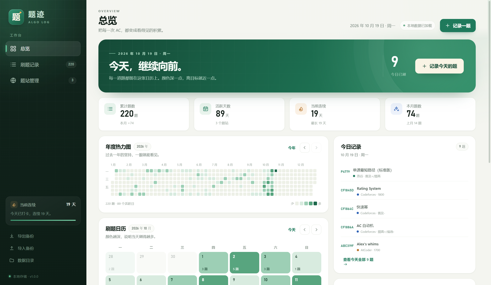

# 题迹 AlgoLog

一个完全本地运行的算法竞赛刷题记录桌面应用。记录题站、每日刷题和难度标签，用月历与年度热力图回看自己的积累。



## 功能

- **题站管理**：手动添加任意 OJ（Codeforces、洛谷、AtCoder……），填写名称和网址，并选择标记颜色。
- **刷题记录**：按日期记录题目名称、题号、题站、难度和标签。题站只能从已经添加的题站中选择。
- **月历 + 年度热力图**：当天记录越多，格子颜色越深；点日期可以查看、补记或编辑当天题目。
- **统计**：累计题数、活跃天数、当前连续、最长连续、本月题数、题站分布。
- **查找与筛选**：按关键词、题站、月份筛选；日历中的日期也可以直接跳转到对应记录。
- **本地持久化**：数据自动保存为 JSON；支持导出/导入备份，应用每天还会自动保留一份数据快照。
- **撤销删除**：删除记录后可以在提示条中撤销。
- **删除保护**：题站下还有记录时不允许直接删除，避免数据悬空。

## 快速开始

### 使用打包版

从 GitHub 的 **Releases** 页面下载 `TiJi-AlgoLog-1.0.0-win64-fixed.zip`，解压到一个固定文件夹。

然后在解压后的文件夹中打开命令提示符（在地址栏输入 `cmd` 回车），执行：

```bat
TiJi-AlgoLog.exe --no-sandbox
```

也可以右键压缩包内的 `启动题迹.cmd`，选择“以命令提示符运行”。如果双击它被文本编辑器打开，说明系统把 `.cmd` 关联成了文本文件，用上面的命令方式启动即可。

首次启动 Windows 可能弹出 SmartScreen 提示，点“更多信息 → 仍要运行”即可。

数据保存在程序目录的 `data` 文件夹中，不再写入 AppData：

```text
程序目录\data\data.json
程序目录\data\backups\
```

移动整个程序文件夹时，`data` 会一起移动。应用内点击左下角 **数据目录** 可以直接打开该文件夹。

### 第一次使用

1. 打开 **题站管理**，添加常用题站，例如：
   - 名称：`Codeforces`，网址：`codeforces.com`
   - 名称：`洛谷`，网址：`luogu.com.cn`
2. 点击右上角 **记录一题**，选择日期和题站，填写题号、题目名称、难度、标签。
3. 回到 **总览** 查看月历和年度热力图；点击日期查看当天题目。

> 题站和刷题记录是两步独立操作：先维护题站，再记录题目；记录题目时不能填写未添加过的题站。

## 快捷键

| 快捷键 | 功能 |
| --- | --- |
| `Ctrl + N` | 快速记录一题 |
| `Ctrl + F` | 打开刷题记录并聚焦搜索框 |
| `Esc` | 关闭当前弹窗 |

## 数据与备份

- 数据文件：`程序目录\data\data.json`
- 自动备份：`程序目录\data\backups\`
- 左下角 **导出备份**：把所有题站和记录导出为一个 JSON 文件。
- 左下角 **导入备份**：选择之前导出的 JSON 覆盖当前数据；覆盖前会自动保留一份当前数据。
- 应用每天首次写入数据时，会自动保留当天的一份快照，最多保留 40 份。

建议定期导出一份备份到网盘或移动硬盘。

## 从源码运行

环境要求：Windows 10/11、Node.js 20+。

```bash
npm install
npm start
```

打包：

```bash
npm run dist
```

打包结果输出到 `release/`，是一个解压即用的 Windows ZIP。如果 Electron 下载缓慢，项目内 `.npmrc` 已配置国内镜像。

## 技术栈

- Electron 44
- 原生 HTML / CSS / JavaScript（无前端框架，离线可用）
- 主进程通过 IPC 读写本地 JSON 文件
- `electron-builder` 生成 Windows 免安装 ZIP

## 目录结构

```text
main.js              Electron 主进程、数据读写、导入导出、窗口
preload.js           安全 IPC 桥
src/index.html       页面骨架
src/styles.css       全部界面样式
src/renderer.js      应用状态、渲染、交互
build/icon.ico       Windows 应用图标
src/assets/icon.png  页面图标 / 窗口图标
scripts/ui-test.mjs  自动化 UI 回归测试（开发用）
screenshots/         README 使用的界面截图
```

